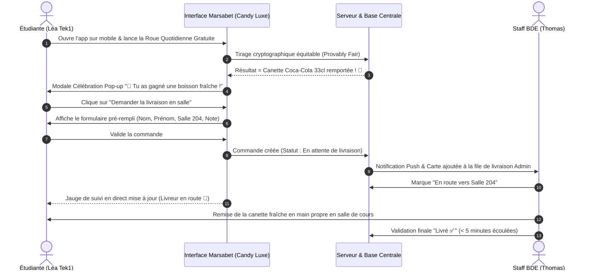

# 🪐 MARSABET — CAHIER DES CHARGES UI/UX & SPÉCIFICATIONS COMPLÈTES DE REFONTE DESIGN
## Édition de Référence : Direction Artistique "Candy Luxe" & Gamification Campus BDE Epitech Marseille

> **Document Maître pour l'Équipe UI/UX, Product Designers & Développeurs Frontend**  
> **Projet** : *Marsabet* — Plateforme Web Récréative, Gamifiée & Associative  
> **Campus** : Epitech Marseille (Promos Tek1 à Tek5 & Staff BDE)  
> **Statut Éthique & Légal** : **100% sans argent réel (0€ engagé)** — Jetons virtuels gratuits (🪙 Jetons Marsabet) échangeables contre de **vrais lots physiques** (Canettes fraîches, chocolats, goodies campus) distribués ou livrés en salle de cours / lab.  
> **Direction Artistique** : **Candy Luxe** (Velours Cassis sombre, Framboise Glacée, Miel Doré, Menthe Électrique, surfaces Dragées & Glassmorphism généreux).

---

## 📑 TABLE DES MATIÈRES DÉTAILLÉE

1. [Résumé Exécutif & Vision Produit](#1-résumé-exécutif--vision-produit)
2. [Personas Étudiants & Parcours Utilisateurs](#2-personas-étudiants--parcours-utilisateurs)
3. [Direction Artistique & Design System "Candy Luxe"](#3-direction-artistique--design-system-candy-luxe)
   - 3.1 Palette Chromatique & Tokens de Couleur
   - 3.2 Typographie & Hiérarchie Textuelle
   - 3.3 Formes, Rayons de Courbure & Surfaces "Dragées"
   - 3.4 Composants Atomiques & États d'Interaction
   - 3.5 Identité Iconographique & Illustrations
4. [Architecture de l'Information & Layouts Responsive](#4-architecture-de-linformation--layouts-responsive)
   - 4.1 Sitemap & Matrice des Écrans
   - 4.2 Layout Desktop (Sidebar Velours 260px & Topbar Flottante)
   - 4.3 Layout Mobile (Bottom Nav Candy & Drawer Épuré)
5. [Composants Globaux Persistants](#5-composants-globaux-persistants)
   - 5.1 Topbar Candy Luxe (Solde Animé, Streak & Profil)
   - 5.2 Ticker de Victoires & Livraisons Campus en Temps Réel
   - 5.3 Barre de Navigation Inférieure Mobile (Candy Bottom Nav)
   - 5.4 Drawer Latéral & Contrôles Audio Synthétisés
6. [Spécifications Complètes Écran par Écran](#6-spécifications-complètes-écran-par-écran)
   - 6.1 Lobby / Accueil du Campus (`/lobby`)
   - 6.2 Catalogue Unifié des 8 Jeux (`/jeux`)
   - 6.3 L'Arène des Roues de la Fortune BDE (`/roues`)
   - 6.4 Hub Récompenses, Boutique & Suivi des Livraisons en Direct (`/recompenses`)
   - 6.5 Le Panthéon / Leaderboard des Promotions (`/classement`)
   - 6.6 Profil Étudiant & Système de Progression VIP Gourmand (`/profil`)
7. [Spécification Détaillée des 8 Jeux (Thématique Candy Luxe)](#7-spécification-détaillée-des-8-jeux-thématique-candy-luxe)
   - 7.1 Crash Cosmique (Fusée Bubblegum & Multiplicateur Menthe)
   - 7.2 Slots Bonbon Galaxie (Machine 5x3 & Scatters Gourmands)
   - 7.3 Blackjack VIP Campus (Feutre Cassis & Cartes Dorées)
   - 7.4 Roulette Européenne (Cylindre Velours & Tapis Complet)
   - 7.5 Plinko Sucré (Pyramide Dragée & Paniers Menthe x50)
   - 7.6 Slider Cosmique (Curseur Tactile 97.5% RTP)
   - 7.7 Jeu de Dés / Craps (Dés Translucides Framboise)
   - 7.8 Roue Cosmique Royale (Multiplicateurs Express)
8. [Panneau d'Administration BDE (Back-Office Mobile-First)](#8-panneau-dadministration-bde-back-office-mobile-first)
   - 8.1 Dispatch & Livraisons en Salle (Validation 1-Clic)
   - 8.2 Générateur & Gestion des Codes Promo
   - 8.3 Configurateur des Roues & Probabilités
   - 8.4 Gestion des Soldes & Comptes Étudiants
   - 8.5 Gestion des Stocks du Frigo BDE
9. [Modales, Pop-ups & Moments "WOW"](#9-modales-pop-ups--moments-wow)
   - 9.1 Modale d'Authentification Candy (Connexion / Inscription +1 000 🪙)
   - 9.2 Modale de Célébration de Gain Physique (Confettis & Pop-up Gourmand)
   - 9.3 Modale Formulaire de Livraison Directe en Salle / Lab
   - 9.4 Modales Internes aux Jeux (Paytable, Gamble, Free Spins)
10. [Design Sonore & Micro-Interactions Haptiques](#10-design-sonore--micro-interactions-haptiques)
11. [Indicateurs de Succès (KPIs) & Guide des Livrables Designer](#11-indicateurs-de-succès-kpis--guide-des-livrables-designer)

---

## 1. RÉSUMÉ EXÉCUTIF & VISION PRODUIT

*Marsabet* est une application web récréative et gamifiée conçue pour transformer les moments de pause, les soirées d'intégration et les événements associatifs d'**Epitech Marseille** en une expérience communautaire festive et chaleureuse.

### Les 3 Piliers Fondamentaux du Projet :
1. **Zéro Argent Réel — Éthique & Gratuité Totale** :  
   Aucun centime d'euro n'est requis ni accepté. Les étudiants reçoivent une dotation de départ de **1 000 jetons virtuels (🪙 Jetons Marsabet)** et recharge quotidienne gratuite (**Daily Streak**).
2. **De la Victoire Numérique au Réconfort Physique Réel** :  
   Les jetons accumulés grâce à l'habileté et la chance permettent de débloquer de **vrais produits physiques** entreposés dans le local du BDE : canettes glacées (Red Bull, Monster, Coca-Cola, Ice Tea), friandises (Kinder Bueno, KitKat Chunky) et goodies campus (hoodies de promo, mugs, stickers).
3. **Livraison Express en Salle de Cours / Lab** :  
   Un système logistique intégré permet à l'étudiant de demander la livraison directement à sa place (ex: *Salle 302, 3ème étage, pull noir au fond*) ou de récupérer son lot au stand associatif en un scan/clic.

---

## 2. PERSONAS ÉTUDIANTS & PARCOURS UTILISATEURS

### 2.1 Matrice des Personas

| Persona | Profil & Promo | Motivations & Attentes | Fréquence & Contexte | Pain Points Actuels |
|---|---|---|---|---|
| **Maxime 'Kernel'** | Tek3 / Tek4 — Joueur Compétitif | Grimper au sommet du Leaderboard de l'école, afficher un badge VIP flamboyant, enchaîner des parties intenses de Crash et Blackjack pendant les temps de compilation. | 3 à 6 sessions courtes par jour (2-3 min) sur smartphone ou laptop. | S'ennuie si l'interface est trop lente ou manque de dynamisme visuel. |
| **Léa 'Pixel'** | Tek1 / Tek2 — Joueuse Récréative | Prendre son spin gratuit sur la Roue Quotidienne pendant la pause café, regarder les lots de friandises disponibles, commander un Kinder Bueno livré à son bureau de lab. | 1 à 2 sessions par jour (matin / pause déj). | Déteste les interfaces complexes de casino sombre ou agressif. Veut du fun et de la bienveillance. |
| **Thomas BDE** | Membre du Bureau BDE / Responsable Stand | Interface ultra-rapide sur mobile pour valider les distributions de boissons, savoir où livrer dans le bâtiment, et créer des codes promo pour animer le Discord de la promo. | Permanent lors des permanences et soirées associatives. | Ne doit pas perdre de temps : l'action "Livré" doit se faire en un clic à une seule main. |

### 2.2 Parcours Utilisateur Phare (Happy Path : Du Spin au Red Bull Frais)


---

## 3. DIRECTION ARTISTIQUE & DESIGN SYSTEM "CANDY LUXE"

La direction **Candy Luxe** rompt avec les codes froids, austères ou agressifs des casinos conventionnels. Elle propose une atmosphère **gourmande, feutrée, prestigieuse et ultra-accueillante**, s'inspirant du design émotionnel d'Apple Arcade, de la gamification engageante de Duolingo, et du raffinement moderne des meilleures plateformes néo-arcade.

### 3.1 Palette Chromatique & Tokens de Couleur

```
┌────────────────────────────────────────────────────────────────────────┐
│                      PALETTE CHROMATIQUE CANDY LUXE                    │
├─────────────────┬─────────────────┬──────────────────┬─────────────────┤
│ VELOURS CASSIS  │ FRAMBOISE GLACÉE│   MIEL DORÉ      │ MENTHE GLACÉE   │
│  (#0E091A)      │  (#FF2D87)      │   (#FF9F43)      │  (#05E6B4)      │
│  Fond Profond   │   CTA Phares    │ Monnaie 🪙 / VIP │  Gains & Succès │
└─────────────────┴─────────────────┴──────────────────┴─────────────────┘
```

| Rôle Visuel | Nom Poétique | Code Hexadécimal | Utilisation dans l'Interface |
|---|---|---|---|
| **Deep Velvet Background** | *Velours Cassis Nocturne* | `#0E091A` | Fond immersif principal de l'application, réduit la fatigue oculaire |
| **Surface Card & Drawer** | *Cassis Doux Teinté* | `#161121` | Fond des conteneurs, cartes de jeux, modales et sidebar |
| **Card Surface Elevated** | *Nectar de Cassis* | `#221A33` | Cartes en survol, badges inactifs, champs de formulaires |
| **Primary Brand / Hero CTA** | *Framboise Glacée* | `#FF2D87` | Boutons d'action prioritaires (*Jouer Maintenant*, *Tourner la Roue*, *Parier*) |
| **Primary Glow / Accent** | *Bubblegum Neon* | `#FF409F` | Lueur au survol, contours actifs, barres de progression en cours |
| **Currency & Luxury Accent** | *Miel Doré d'Ambre* | `#FF9F43` | Solde de jetons 🪙, couronnes du podium, icônes des multiplicateurs |
| **Secondary Gold Glow** | *Sucre Doré Scintillant* | `#FFD152` | Étoiles, reflets métalliques doux, rangs VIP supérieurs |
| **Success & Dynamic Gains** | *Menthe Glacée Électrique*| `#05E6B4` | Chiffres des gains positifs (`+450 🪙`), multiplicateurs en vol, statut "Livré" |
| **Cyan Cosmic Shimmer** | *Sirocco Givré* | `#22D3EE` | Multiplicateurs records (>10x), traînées de particules, rang Platine |
| **Danger & Crash Alert** | *Cerise Griotte* | `#F43F5E` | Explosion du crash, pertes, solde insuffisant, boutons annuler |
| **Texte Principal** | *Crème Perle* | `#FDF8F5` | Titres, soldes principaux, textes à fort contraste |
| **Texte Secondaire** | *Brume Lavande* | `#A79EB5` | Descriptions, sous-titres, libellés de métadonnées |
| **Bordure Glassmorphism** | *Liseré Cristal Rose* | `rgba(255, 45, 135, 0.15)` | Filets de bordure ultra-fins apportant un relief précieux |

---

### 3.2 Typographie & Hiérarchie Textuelle

L'ensemble de la typographie est résolument moderne, chaleureuse et fluide. **Aucune police monospace froide typée terminal d'ordinateur n'est autorisée.**

1. **Titres & Display (Titres de pages, En-têtes de jeux, Rangs VIP)** :
   - *Police* : **`Syne`** (Alternative : **`Plus Jakarta Sans`** en graisses ExtraBold/Black).
   - *Caractéristiques* : Lettres généreuses, courbes ouvertes, esprit festif et haut de gamme.
   - *Tailles types* : H1 Hero (`40px` à `48px`), H2 Sections (`28px` à `32px`), H3 Cartes (`20px` à `22px`).
2. **Interface, Boutons & Formulaires (Body Text)** :
   - *Police* : **`Outfit`** (Alternative : **`Plus Jakarta Sans`**).
   - *Caractéristiques* : Grande lisibilité sur écran tactile, géométrie adoucie, interlignage aéré.
   - *Tailles types* : Body standard (`15px` / `16px`), Boutons (`16px` Bold), Labels (`12px` / `13px` SemiBold).
3. **Chiffres, Soldes & Multiplicateurs (Scoreboards & Compteurs)** :
   - *Police* : **`Outfit`** avec variante de style tabulaire (`font-variant-numeric: tabular-nums`).
   - *Caractéristiques* : Zéro décalage horizontal pendant le défilement des multiplicateurs ou l'incrémentation des gains.

---

### 3.3 Formes, Rayons de Courbure & Surfaces "Dragées"

- **Forme "Dragée" Généreuse** :  
  Tous les éléments interactifs adoptent des rayons de courbure très doux :
  - Petits badges & pilules : `rounded-full` (rayon `9999px`).
  - Boutons d'action : `rounded-2xl` (`16px`) ou `rounded-full`.
  - Cartes de contenu & Modales : `rounded-3xl` (`24px` à `28px`).
- **Surfaces Glassmorphism Doux** :  
  Fond semi-transparent (`rgba(22, 17, 33, 0.75)`), avec flou d'arrière-plan prononcé (`backdrop-filter: blur(20px)`), complété par une bordure subtile de 1px en dégradé rose/ambre pour capter la lumière.
- **Effet de Glaçage (Glossy Sheen)** :  
  Léger dégradé blanc transparent en partie supérieure des cartes simulant la brillance d'une confiserie ou d'un bonbon glacé.

---

### 3.4 Composants Atomiques & États d'Interaction

```
┌────────────────────────────────────────────────────────────────────────┐
│                   BOUTONS CANDY LUXE & VARIANTES                       │
├────────────────────────────────────────────────────────────────────────┤
│  [  🎰 JOUER MAINTENANT  ]   --> Framboise Glacée (#FF2D87) + Ombre    │
│  (  🪙 2 000 JETONS      )   --> Miel Doré Pill (#FF9F43)              │
│  [  ✅ MARQUER LIVRÉ     ]   --> Menthe Électrique (#05E6B4)           │
│  [  Annuler / Retour     ]   --> Glass Cassis Translucide              │
└────────────────────────────────────────────────────────────────────────┘
```

1. **Bouton Primaire "Framboise Glacée"** :
   - Dégradé subtil `linear-gradient(135deg, #FF409F 0%, #FF2D87 100%)`.
   - Ombre portée diffuse : `box-shadow: 0 8px 24px rgba(255, 45, 135, 0.35)`.
   - *Hover* : Échelle `1.03`, brillance accentuée.
   - *Active* : Enfoncement doux `scale(0.97)`.
2. **Bouton Monétaire "Miel Doré"** :
   - Dégradé `linear-gradient(135deg, #FFD152 0%, #FF9F43 100%)`.
   - Texte sombre à fort contraste pour une lisibilité parfaite.
3. **Boutons Raccourcis de Mise Gaming** :
   - Pilules tactiles compactes : `Min`, `1/2`, `2x`, `Max`, `+100`, `+500`.
   - Fond verre teinté avec bordure réactive qui s'illumine en rose framboise lors du clic.
4. **Jauges de Progression en "Sucette Glacée"** :
   - Piste de fond velours sombre avec barre de remplissage en dégradé fluorescent menthe ou miel doré, embout arrondi et reflet lumineux.

---

## 4. ARCHITECTURE DE L'INFORMATION & LAYOUTS RESPONSIVE

### 4.1 Sitemap & Matrice des Écrans

```
                              ┌────────────────┐
                              │  / (Racine)    │
                              └───────┬────────┘
                                      │
         ┌──────────────┬─────────────┼──────────────┬──────────────┐
         ▼              ▼             ▼              ▼              ▼
   ┌───────────┐  ┌───────────┐ ┌───────────┐  ┌───────────┐  ┌───────────┐
   │  /lobby   │  │   /jeux   │ │  /roues   │  │/recompenses│ │/classement│
   │  Accueil  │  │ 8 Jeux    │ │3 Roues BDE│  │ Suivi &   │  │  Podium   │
   │  Campus   │  │ Catalogue │ │ Frigo BDE │  │ Boutique  │  │ & Promos  │
   └───────────┘  └─────┬─────┘ └───────────┘  └───────────┘  └───────────┘
                        │
       ┌──────────┬─────┴─────┬──────────┐            ┌───────────┐
       ▼          ▼           ▼          ▼            │  /profil  │
   /jeux/crash /jeux/slots /jeux/bj   ... (8 jeux)    │ VIP & Rec │
                                                      └─────┬─────┘
                                                            ▼
                                                      ┌───────────┐
                                                      │  /admin   │
                                                      │ Staff BDE │
                                                      └───────────┘
```

---

### 4.2 Layout Desktop (Sidebar Velours 260px & Topbar Flottante)

- **Sidebar Fixe Gauche (Largeur 260px)** :
  - En-tête : Logo Marsabet avec planète stylisée bonbon framboise et lettrage doré.
  - Menu de navigation vertical avec icônes illustrées colorées (Lobby, Jeux, Roues BDE, Récompenses, Leaderboard).
  - Bloc dépliable accordéon pour les 8 jeux individuels.
  - Carte Profil / VIP miniature en bas de sidebar : avatar de l'étudiant avec badge de rang, barre de progression vers le rang suivant et bouton Son On/Off.
- **Header Supérieur Sticky** :
  - Bandeau ticker de victoires en direct.
  - Badge cliquable du solde de jetons 🪙.
  - Bouton pétillant du Bonus Quotidien avec jauge de streak.
  - Bouton d'accès au profil étudiant ou modale d'authentification.
- **Zone Centrale** : Largeur maximale `1440px`, marges latérales généreuses et aérées.

---

### 4.3 Layout Mobile (Bottom Nav Candy & Drawer Épuré)

- **Mobile First Obligatoire** : 75% des étudiants consultent l'application sur smartphone (iPhone & Android) pendant les cours et pauses.
- **Candy Bottom Nav (Barre Inférieure Fixe avec 5 Onglets)** :
  - Toujours accessible sous le pouce :
    1. 🏠 **Accueil** (`/lobby`)
    2. 🎰 **Jeux** (`/jeux`)
    3. 🎡 **Roues** (`/roues`) — avec pastille lumineuse `1 Gratuit`
    4. 🎁 **Cadeaux** (`/recompenses`) — avec compteur des livraisons en cours
    5. 👤 **Profil** (`/profil`)
  - L'onglet actif se soulève légèrement avec un halo rose framboise doux.
- **Header Mobile Allégé** :
  - Logo compact, solde de jetons condensé (ex: `14.2k 🪙`), bouton de bonus quotidien et burger menu ouvrant le tiroir pour les options secondaires (audio, règles, admin).

---

## 5. COMPOSANTS GLOBAUX PERSISTANTS

### 5.1 Topbar Candy Luxe
1. **Compteur de Solde Dynamique (🪙 Jetons Marsabet)** :
   - Chiffres géants couleur miel doré.
   - Animation douce de comptage incrémental (`count-up`) lors d'un gain avec gerbe d'étoiles dorées.
   - Clic sur le badge : ouvre directement la section de recharge ou le profil.
2. **Widget Streak & Bonus Journalier** :
   - Icône de flamme chaleureuse 🔥 avec le nombre de jours consécutifs (ex: `🔥 Série 5 jours`).
   - Bouton d'action festif :
     - Si disponible : `🎁 Récupérer (+150 🪙)` avec animation de pulsation.
     - Si déjà collecté : Compte à rebours adouci `Prochain bonus dans 11h 45m`.
3. **Statut de Connexion & Menu Profil** :
   - Avatar rond façon macarons aux couleurs du rang VIP de l'élève.
   - Pseudo visible et menu contextuel rapide (Mon Compte, Mes Commandes BDE, Déconnexion).

---

### 5.2 Ticker de Victoires & Livraisons Campus en Temps Réel
- Un bandeau horizontal translucide défilant doucement sous la Topbar.
- Il annonce en temps réel la vie festive du campus :
  - `🎉 Maxime (Tek3) vient de remporter 2 400 🪙 sur Crash Cosmique !`
  - `🥤 Léa (Tek1) a gagné une Canette Coca-Cola sur la Roue Quotidienne !`
  - `🚀 Livraison en cours : Canette Red Bull vers la Salle 204 !`
- Permet de créer un sentiment d'effervescence collective et prouve que les vrais lots sont réellement distribués.

---

## 6. SPÉCIFICATIONS COMPLÈTES ÉCRAN PAR ÉCRAN

### 6.1 Lobby / Accueil du Campus (`/lobby`)

#### Rôle de l'écran :
La porte d'entrée festive qui met l'étudiant immédiatement dans l'ambiance et lui donne envie de jouer et de découvrir les récompenses du jour.

```
┌────────────────────────────────────────────────────────────────────────┐
│                        HERO BANNER CANDY LUXE                          │
│   🪐 MARSABET — LE CASINO GOURMAND DU BDE EPITECH MARSEILLE           │
│   "Gagne tes jetons gratuits et fais-toi livrer un Red Bull glacé"     │
│   [ 🎰 JOUER MAINTENANT ]      [ 🎁 TOURNER LA ROUE DU JOUR ]          │
├────────────────────────────────────────────────────────────────────────┤
│  TÉLÉMÉTRIE CAMPUS :                                                   │
│  👥 312 Étudiants   🎲 18 420 Parties   🪙 5.2M Jetons   🥤 94 Livrées │
├────────────────────────────────────────────────────────────────────────┤
│  ROUE QUOTIDIENNE DU BDE (CARTE GÉANTE AVEC TIMER EN DIRECT)           │
├────────────────────────────────────────────────────────────────────────┤
│  LES 8 JEUX DU CAMPUS (GRILLE DE CARTES BONBONS VIBRANTES)             │
├────────────────────────────────────────────────────────────────────────┤
│  LE PODIUM DE LA SEMAINE (TOP 3 AVEC MÉDAILLES & PROMOS TEK1-TEK5)     │
├────────────────────────────────────────────────────────────────────────┤
│  COMMENT ÇA MARCHE ? (3 ÉTAPES LUDIQUES SANS ARGENT RÉEL)              │
└────────────────────────────────────────────────────────────────────────┘
```

#### Éléments détaillés à concevoir :
1. **Hero Banner Gourmande** :
   - Fond visuel doux mêlant planète aux anneaux dragée, canette glacée en lévitation et jetons d'or scintillants.
   - Accroche percutante et accueillante.
   - Deux boutons CTA principaux : `🎰 Découvrir les Jeux` (Framboise) et `🎁 Roue Gratuite du Jour` (Miel Doré).
2. **Télémétrie Campus Conviviale (4 Cartes Pilules)** :
   - *Étudiants Actifs* (ex: 👥 312 inscrits).
   - *Parties Jouées 24h* (ex: 🎲 18 420).
   - *Jetons Gagnés* (ex: 🪙 5.2M distribués).
   - *Boissons Livrées* (ex: 🥤 94 canettes remises en cours).
3. **Mise en Avant "Roue Quotidienne BDE"** :
   - Carte grand format avec visuel de la roue colorée et appel à l'action immédiat.
4. **Grille des Jeux Phares** :
   - Cartes illustrées des 8 jeux avec effet de brillance glossy au survol.
5. **Mini-Podium de la Semaine (Top 3)** :
   - Les 3 meilleurs étudiants du campus mis à l'honneur avec leur promo (Tek1, Tek2, Tek3, Tek4, Tek5), leur fortune virtuelle et le lot réel qu'ils ont débloqué.
6. **Guide en 3 Étapes "Zéro Risque, Zéro Euro"** :
   - 1. *Joue Gratuitement* (1 000 jetons offerts + recharge chaque jour).
   - 2. *Décroche des Lots* (Gagne des canettes & friandises sur les roues).
   - 3. *Livraison en Salle* (Le BDE t'apporte ta boisson directement à ta table).

---

### 6.2 Catalogue Unifié des 8 Jeux (`/jeux`)

#### Rôle de l'écran :
Permettre de trouver instantanément son jeu favori grâce à une navigation claire, des filtres en dragées et des cartes informatives.

#### Éléments détaillés à concevoir :
1. **Barre de Recherche & Filtres en Pilules Dragées** :
   - Champ de recherche instantané avec icône loupe adoucie.
   - Filtres cliquables avec compteurs intégrés :
     - `Tous les jeux (8)`
     - `🚀 Crash & Arcade (3)` *(Crash, Plinko, Slider)*
     - `🃏 Cartes & Table (2)` *(Blackjack, Roulette)*
     - `🎰 Machines à Sous (1)` *(Slots Bonbon Galaxie)*
     - `🎲 Dés & Hasard (2)` *(Dés Craps, Roue Royale)*
2. **Cartes de Jeu Candy Luxe (Game Cards)** :
   - Ratio 16:9 ou 4:3 avec coins très arrondis (`rounded-3xl`).
   - Image 3D colorée et gourmande personnalisée pour chaque jeu.
   - Badge supérieur : `HOT 🔥`, `NOUVEAU ✨`, `RTP 97.5%`, `JACKPOT x100`.
   - Titre du jeu en typographie *Syne* + descriptif court en *Outfit*.
   - Bouton de lancement instantané `Jouer ▶`.

---

### 6.3 L'Arène des Roues de la Fortune BDE (`/roues`)

#### Rôle de l'écran :
Le point de convergence de l'économie Marsabet où les étudiants tournent la roue pour remporter les stocks du local associatif.

```
┌────────────────────────────────────────────────────────────────────────┐
│               L'ARÈNE DES ROUES DE LA FORTUNE BDE                      │
│   "Tourne la roue, débloque des vraies canettes et des chocolats"      │
├────────────────────────────────────────────────────────────────────────┤
│  SÉLECTEUR DE ROUE EN 3 DRAGÉES :                                      │
│  [ ✨ Roue Quotidienne (0 🪙) ] [ 🥤 Roue 2 000 🪙 ] [ ⚡ Roue 3 000 🪙 ]│
├────────────────────────────────────────────────────────────────────────┤
│                                                                        │
│                      CANVAS DE LA GRANDE ROUE                          │
│               (Segments Colorés Bonbons, Aiguille Dorée,               │
│                   Décélération Réaliste de 4.6 sec)                    │
│                                                                        │
│                     [ 🎁 TOURNER LA ROUE DU BDE ]                      │
│                                                                        │
├────────────────────────────────────────────────────────────────────────┤
│  TABLEAU DES PROBABILITÉS & LOTS  │  JAUGE DU FRIGO BDE (STOCKS RÉELS) │
│  - 50 à 1 000 Jetons              │  - Coca-Cola 33cl : 18 canettes    │
│  - Canettes au choix              │  - Red Bull 250ml : 9 canettes     │
│  - Kinder Bueno & KitKat          │  - Kinder Bueno : 14 barres        │
└────────────────────────────────────────────────────────────────────────┘
```

#### Les 3 Roues Spécifiées :
1. **Roue Quotidienne BDE (100% Gratuite / 24h)** :
   - Coût : `0 🪙`.
   - Accessible 1 fois toutes les 24 heures par compte étudiant.
   - Segments : 50, 100, 150, 250, 500, 1 000 🪙 + Canette Coca-Cola 33cl + Kinder Bueno.
2. **Roue Gourmande (2 000 🪙 par tour)** :
   - Coût : `2 000 🪙`.
   - Limite : 5 tours par jour maximum (sécurité anti-épuisement des stocks).
   - Segments : 250 🪙 de consolation + Canettes au choix (Oasis, Ice Tea, Sprite) + Barres chocolatées.
3. **Roue Red Bull Suprême (3 000 🪙 par tour)** :
   - Coût : `3 000 🪙`.
   - Limite : 5 tours par jour maximum.
   - Segments : 300 🪙 de consolation + 20% de chances de remporter une véritable canette de Red Bull 250ml fraîche.
4. **La Jauge du Frigo BDE (Transparence des Stocks)** :
   - Encart dynamique montrant en direct les stocks restants au local associatif pour garantir la confiance des étudiants.

---

### 6.4 Hub Récompenses, Boutique & Suivi des Livraisons en Direct (`/recompenses`)

#### Rôle de l'écran :
Suivre le parcours de sa commande en temps réel et permettre l'échange direct de jetons contre des boissons ou goodies au comptoir.

#### Éléments détaillés à concevoir :
1. **Module "Suivi de Livraison en Direct" (Live Order Tracker)** :
   - Lorsqu'une commande est active, une bannière animée en haut de page affiche :
     - Numéro de commande (ex: `#MB-4892`).
     - Produit : *Canette Red Bull 250ml fraîche*.
     - Destination : *Salle 302, 3ème étage, place côté baie vitrée*.
     - Barre de progression en 3 étapes lumineuses :
       1. `Commande Reçue 📝`
       2. `Livreur en Route vers ta Salle 🚀`
       3. `Livré & Dégusté 🥤`
2. **Boutique d'Échange Direct au Comptoir BDE** :
   - Grille de cartes pour acheter directement avec ses jetons sans passer par la roue :
     - *Canettes Standards 33cl* : 2 500 🪙.
     - *Canette Red Bull / Monster* : 3 500 🪙.
     - *Kinder Bueno / KitKat Chunky* : 2 000 🪙.
     - *Hoodie Officiel Epitech Marseille* : 50 000 🪙.
   - Affichage du stock en temps réel sur chaque carte.
3. **Historique des Récompenses Remises** :
   - Liste des 5 dernières commandes de l'étudiant avec horodatage, statut et nom du membre BDE qui a effectué la livraison.

---

### 6.5 Le Panthéon / Leaderboard des Promotions (`/classement`)

#### Rôle de l'écran :
Le moteur de fierté et de compétition amicale entre les étudiants et les promotions (Tek1, Tek2, Tek3, Tek4, Tek5).

#### Éléments détaillés à concevoir :
1. **Filtres Périodiques en Dragées** :
   - `Cette Semaine (Lots réels en jeu)`
   - `Ce Mois-ci`
   - `Tous les Temps (Légendes de l'École)`
2. **Le Podium Festif 3D (Top 3)** :
   - **1ère Place (Centre, surélevé)** : Piédestal miel doré, grande couronne animée, avatar avec aura scintillante, pseudo, promotion (ex: *Tek3*), solde géant et flamme de streak.
   - **2ème Place (Gauche)** : Piédestal framboise argentée avec médaille 🥈.
   - **3ème Place (Droite)** : Piédestal ambre bronze avec médaille 🥉.
3. **Bandeau Sticky "Ta Position Personnelle" (Mobile)** :
   - Barre fixe en bas d'écran rappelant : *"Tu es classé #14 avec 58 400 🪙 — Plus que 3 200 🪙 pour dépasser Alexandre (Tek2) !"*.
4. **Tableau Complet des Promotions** :
   - Colonnes claires et lisibles : Rang, Étudiant & Badge VIP, Promo (Tek1-Tek5), Fortune en 🪙, Série de connexion 🔥, Plus gros gain historique.
   - Ligne du joueur connecté surlignée en velours framboise doux.

---

### 6.6 Profil Étudiant & Système de Progression VIP Gourmand (`/profil`)

#### Rôle de l'écran :
L'espace personnel de l'élève pour mesurer sa fidélité, suivre son niveau VIP et activer les codes promo du BDE.

#### Éléments détaillés à concevoir :
1. **En-tête de Profil & Macaron VIP** :
   - Grand avatar avec contour lumineux aux couleurs du rang VIP.
   - Pseudo, Promo, Identifiant et Rang général sur le campus.
2. **Grille des 6 Métriques du Joueur** :
   - 🪙 *Solde Disponible Actuel*
   - 🎲 *Parties Jouées au Total*
   - 💥 *Plus Gros Gain Réalisé*
   - 📈 *Total des Gains Cumulés*
   - 🔥 *Série de Connexion Quotidienne (Streak)*
   - 🎰 *Total Misé (Wager Global)*
3. **Le Club VIP des 6 Paliers Gourmands** :
   - Le statut VIP est calculé automatiquement selon le total des mises effectuées :

| Palier VIP | Nom du Rang | Couleur & Aura | Multiplicateur Bonus | Avantage Exclusif Débloqué |
|---|---|---|---|---|
| **Tier 1** | 🥉 **Bronze** | Ambre Cuivré (`#CD7F32`) | `x1.00` | Statut joueur de base, accès aux roues |
| **Tier 2** | 🥈 **Argent** | Nacre Givrée (`#CBD5E1`) | `x1.10` | +10% sur les bonus quotidiens, badge argent |
| **Tier 3** | 🥇 **Or** | Miel Doré (`#FFD152`) | `x1.25` | +25% sur les bonus, liseré doré sur le podium |
| **Tier 4** | 💎 **Platine** | Menthe Azur (`#05E6B4`) | `x1.40` | +40% sur les bonus, aura menthe glacée |
| **Tier 5** | 👑 **Diamant** | Framboise Royale (`#FF2D87`)| `x1.60` | +60% sur les bonus, couronne violette |
| **Tier 6** | 🪐 **Maître Marsabet** | Cerise Cosmique (`#F43F5E`)| `x2.00` | Multiplicateur x2 sur tous les bonus, statut légende |

4. **Section "Activer un Code Promo BDE"** :
   - Champ de saisie adouci pour entrer les codes distribués lors des animations ou sur Discord (ex: `MARSA-EPITECH`).
   - Bouton de validation instantanée `Activer le Code 🚀`.
   - Liste des codes promo déjà réclamés avec le montant crédité.
5. **Historique des 25 Dernières Parties** :
   - Tableau épuré des dernières parties jouées avec le jeu, la mise, le gain et le profit net en vert menthe ou rouge cerise.

---

## 7. SPÉCIFICATION DÉTAILLÉE DES 8 JEUX (THÉMATIQUE CANDY LUXE)

### 7.1 Crash Cosmique (Fusée Bubblegum & Multiplicateur Menthe) (`/jeux/crash`)

- **Ambiance** : Une fusée spatiale rose bubblegum décolle dans une nuit velours cassis constellée de bonbons et d'étoiles néon.
- **Mécanique** :
  - Le multiplicateur démarre à `1.00x` et grimpe selon une courbe exponentielle fluide.
  - La valeur numérique centrale grossit et palpite en vert menthe électrique (`#05E6B4`).
  - Bouton interactif géant :
    - *Avant le lancement* : Bouton Vert Menthe `LANCER LE VOL (Mise 500 🪙)`.
    - *Pendant l'ascension* : Bouton Framboise Vibrant `ENCAISSER (Gain : 1 840 🪙)`.
  - Option d'**Auto-Cashout** (ex: encaissement automatique dès `2.50x`).
  - Animation de crash : La fusée éclate en une nuée de confettis multicolores avec le message `CRASHED @ 4.18x`.
  - Bandeau supérieur des 10 derniers multiplicateurs sous forme de dragées colorées.

---

### 7.2 Slots Bonbon Galaxie (Machine 5x3 & Scatters Gourmands) (`/jeux/slots`)

- **Ambiance** : Machine à sous 5 rouleaux x 3 rangées encadrée de liserés dorés et dragées lumineuses.
- **Les 8 Symboles Gourmands** :
  1. *Planète Mars Bonbon* (Jackpot suprême x100)
  2. *Diamant de Sucre Candi*
  3. *Couronne en Miel d'Or*
  4. *Triple Sept (777) Caramélisé*
  5. *Étoile Gélifiée*
  6. *Cloche Sucrée*
  7. *Fer à Cheval Glaçage Rose*
  8. *Logo BDE Marseille (Scatter / Déclencheur Free Spins)*
- **Fonctionnalités Clés** :
  - 10 ou 20 lignes de paiement traçables en lignes néon colorées lors des gains.
  - Bouton `SPIN` circulaire géant central + boutons `AUTO-SPIN` et `TURBO`.
  - Modale **Paytable** illustrée expliquant chaque combinaison.
  - Mini-jeu **Gamble (Quitte ou Double)** : deviner la couleur de la dragée (Rouge/Noir x2) ou sa forme (x4).
  - Mode **Free Spins** : 10 tours gratuits avec multiplicateur x3 et ambiance néon dorée festive.

---

### 7.3 Blackjack VIP Campus (Feutre Cassis & Cartes Dorées) (`/jeux/blackjack`)

- **Ambiance** : Tapis de feutre incurvé en velours cassis profond (`#161121`), avec lignes de marquage dorées fines et élégantes.
- **Règles Campus** :
  - Contre le croupier BDE, sabot de 6 jeux mélangés.
  - Blackjack naturel payé 3:2, As dynamique (1 ou 11 avec affichage souple `7 / 17`).
  - Prise en charge du jeu **Multi-Mains** (jusqu'à 3 mains simultanées) et fonction **Split** sur les paires.
  - Sidebets optionnels : *Perfect Pairs* (paires parfaites) et *21+3* (combinaison poker).
- **Interface Joueur** :
  - Cartes grand format faciles à lire sur mobile, avec animation de distribution glissée depuis le sabot.
  - Boutons d'action contextuels qui s'allument quand c'est le tour de la main :
    - `🃏 Tirer (Hit)`
    - `🛑 Rester (Stand)`
    - `⚡ Doubler (Double)`
    - `✂️ Séparer (Split)`

---

### 7.4 Roulette Européenne (Cylindre Velours & Tapis Complet) (`/jeux/roulette`)

- **Ambiance** : Vue du dessus immersive combinant un cylindre européen laqué noir et or avec une bille nacrée, et un tapis de feutre cassis doux.
- **Règles & Mises** :
  - 37 numéros (0 vert + numéros de 1 à 36 rouges et noirs).
  - Tapis complet : numéros pleins (x36), chevaux (x18), transversales (x12), carrés (x9), sixains (x6), douzaines et colonnes (x3), rouge/noir, pair/impair, manque/passe (x2).
- **Contrôles Tactiles** :
  - Barillet de jetons de mise aux couleurs de dragées : `10`, `50`, `100`, `500`, `1 000 🪙`.
  - Jetons empilables avec zoom automatique sur la case gagnante à la fin de la rotation de la bille.
  - Ruban des 10 derniers numéros sortis avec indicateurs Chauds / Froids.

---

### 7.5 Plinko Sucré (Pyramide Dragée & Paniers Menthe x50) (`/jeux/plinko`)

- **Ambiance** : Une pyramide verticale de quilles lumineuses dans un décor spatial feutré.
- **Mécanique** :
  - Des billes brillantes tombent du sommet avec moteur physique réaliste (gravité et rebonds sonores cristallins).
  - Sélecteur de niveau de risque : `Faible`, `Moyen`, `Élevé`.
  - Sélecteur de rangées de quilles : 8 à 16 rangées.
  - Paniers récepteurs au bas : le centre rapporte des coefficients modestes (`0.5x`, `1x`), tandis que les extrémités flamboyantes s'envolent jusqu'à **x50**.
  - Possibilité de lâcher plusieurs billes en rafale rapide.

---

### 7.6 Slider Cosmique (Curseur Tactile 97.5% RTP) (`/jeux/slider`)

- **Ambiance** : Un curseur horizontal ultra-fluide avec jauge bicolore brillante (vert menthe pour la zone gagnante, rose framboise pour la zone de risque).
- **Mécanique** :
  - L'étudiant glisse le curseur pour fixer une cible entre 2 et 98.
  - Bascule en un clic entre le mode **Under (Inférieur)** et **Over (Supérieur)**.
  - Calcul dynamique en direct du multiplicateur et du pourcentage exact de chance de victoire (RTP fixé à 97.5%).
  - Curseur d'animation qui glisse et s'arrête avec précision sur le résultat du tirage avec compteur à deux décimales.

---

### 7.7 Jeu de Dés / Craps (Dés Translucides Framboise) (`/jeux/des`)

- **Ambiance** : Deux dés cubiques translucides couleur framboise avec points dorés et coins légèrement adoucis roulant sur un tapis velouté.
- **Deux Modes de Jeu** :
  1. *Mode Craps Campus* : Paris directs sur le 7 Chanceux (x4), les Craps 2, 3, 12 (x5), les Doubles identiques (x6) ou le Total Bas/Haut (x2).
  2. *Mode Over/Under Classique* : Pari sur la somme des deux dés au-dessus ou en-dessous de 7.

---

### 7.8 Roue Cosmique Royale (Multiplicateurs Express) (`/jeux/roue`)

- **Ambiance** : Roue circulaire à 16 segments colorés aux finitions velours et miel doré.
- **Mécanique** : Multiplicateurs instantanés allant de `0x` à `25x Jackpot Royal`.
- Animation de rotation fluide avec cliquetis de l'aiguille supérieure et arrêt net.

---

## 8. PANNEAU D'ADMINISTRATION BDE (BACK-OFFICE MOBILE-FIRST) (`/admin`)

Cette interface est conçue pour les membres du BDE assurant les permanences au stand ou circulant dans les couloirs du campus. **Elle doit être utilisable à une seule main sur smartphone.**

```
┌────────────────────────────────────────────────────────────────────────┐
│                   PANNEAU D'ADMINISTRATION BDE                         │
│   [ 🛵 Livraisons (4) ] [ 🎟️ Codes Promo ] [ 🎡 Roues ] [ 👥 Élèves ]  │
├────────────────────────────────────────────────────────────────────────┤
│  FILE DES COMMANDES EN DIRECT :                                        │
│  ┌──────────────────────────────────────────────────────────────────┐  │
│  │ 🥤 CANETTE COCA-COLA 33CL                   ⏳ À LIVRER EN SALLE │  │
│  │ Élève : Maxime Durand (Tek3) — 📞 06 12 34 56 78                 │  │
│  │ Lieu  : Salle 304, 3ème étage (au fond près de la fenêtre)       │  │
│  │ Heure : Il y a 3 minutes                                         │  │
│  │ [ 🚀 EN ROUTE ]   [ ✅ MARQUER COMME LIVRÉ ]   [ ❌ ANNULER ]    │  │
│  └──────────────────────────────────────────────────────────────────┘  │
└────────────────────────────────────────────────────────────────────────┘
```

### Les 5 Onglets Admin :
1. **Dispatch & Livraisons en Salle (Orders / Deliveries)** :
   - File d'attente des demandes de boissons et snacks triée par urgence.
   - Carte complète affichant : Nom, Prénom, Salle de cours, Téléphone cliquable (pour appeler immédiatement en cas de doute) et note de repérage.
   - Bouton géant `✅ Marquer comme Livré` pour valider la remise en main propre en 1 clic.
2. **Gestionnaire de Codes Promo** :
   - Générateur de codes aléatoires (ex: `MARSA-MARS26`).
   - Définition du montant de jetons offerts (ex: `500 🪙`), de la limite d'utilisations (ex: `50 étudiants`) et de la date d'expiration.
   - Tableau de suivi en temps réel du taux d'utilisation des codes.
3. **Configurateur des Roues BDE** :
   - Interface d'édition des segments des 3 roues sans toucher au code.
   - Ajustement des probabilités, des libellés, des couleurs et des lots physiques reliés au catalogue.
4. **Gestion des Soldes & Utilisateurs** :
   - Recherche rapide par pseudo d'étudiant.
   - Modale pour créditer ou débiter des jetons en cas de litige ou d'animation spéciale.
   - Gestion des rôles (`Étudiant` ou `Staff Admin BDE`).
5. **Inventaire du Frigo BDE (Stocks Réels)** :
   - Ajustement en 1 clic des quantités de canettes et friandises restantes au local.

---

## 9. MODALES, POP-UPS & MOMENTS "WOW"

### 9.1 Modale d'Authentification Candy (`#authModal`)
- Onglets basculables `Connexion` et `Inscription`.
- Message festif : *"🎉 1 000 jetons offerts immédiatement dès la création de ton compte !"*.
- Formulaire épuré avec boutons pour afficher/masquer le mot de passe (`👁️`).

### 9.2 Modale de Célébration de Gain Physique (`#physicalWinModal`)
- **Le pic émotionnel de l'application** :
  - Déclenchée instantanément dès qu'un élève gagne une canette ou un chocolat sur une roue.
  - Pluie de confettis dorés et roses sur tout l'écran.
  - Image 3D éclatante du lot remporté (ex: Canette de Red Bull rayonnante).
  - Titre triomphal : *"🎉 FÉLICITATIONS ! TU AS GAGNÉ UNE VRAIE BOISSON BDE !"*.
  - Bouton d'action principal bien mis en avant : `📍 Me faire livrer en salle maintenant 🚀`.
  - Bouton secondaire : `Récupérer plus tard au stand BDE`.

### 9.3 Modale Formulaire de Livraison Directe (`#deliveryRequestModal`)
- Formulaire fluide demandant :
  - *Nom & Prénom* de l'étudiant.
  - *Salle de cours / Lab* (ex: *Salle 204, 2ème étage*).
  - *Numéro de téléphone* (facultatif mais recommandé).
  - *Note spéciale pour le livreur* (ex: *Pull noir, 2ème rangée au milieu*).
- **Mémorisation intelligente** : Ces coordonnées sont automatiquement sauvegardées dans le navigateur (`localStorage`) pour que l'étudiant n'ait plus jamais à les ressaisir lors de ses prochains gains.

---

## 10. DESIGN SONORE & MICRO-INTERACTIONS HAPTIQUES

Marsabet intègre un moteur audio entièrement généré en direct par la **Web Audio API** (zéro chargement de fichiers externes lents) :

1. **Jeton / Mise** : Petit son sec et velouté de jeton en céramique (`click doux`).
2. **Rotation des Roues & Rouleaux** : Cliquetis mécanique continu et satisfaisant avec décélération progressive.
3. **Distribution de Cartes** : Bruit feutré réaliste d'une carte qui glisse sur la table.
4. **Victoire Standard** : Jingle ascendant de 3 notes cristallines.
5. **Jackpot ou Lot Physique Gagné** : Fanfare éclatante suivie du tintement d'une cascade de pièces.
6. **Crash de la Fusée** : Fréquence basse étouffée avec écho spatial doux.

---

## 11. INDICATEURS DE SUCCÈS (KPIS) & GUIDE DES LIVRABLES DESIGNER

### 11.1 Indicateurs Clés de Succès (KPIs)
1. **Engagement Quotidien (DAU / MAU)** : > 65% des étudiants d'Epitech Marseille effectuant au moins un spin par jour.
2. **Délai Logistique Moyen** : Moins de **6 minutes** entre le gain d'une boisson et sa remise en main propre en salle de cours.
3. **Zéro Litige Monétaire** : 100% de conformité éthique associative (0€ d'argent réel engagé).
4. **Satisfaction UX Perçue** : Note globale > 4.8/5 sur l'ergonomie mobile et le plaisir visuel.

### 11.2 Livrables Attendus du UI/UX Designer
Le designer en charge de la refonte complète doit fournir :
1. **Design System Figma "Candy Luxe"** :
   - Palette des tokens de couleurs (Velours Cassis, Framboise, Miel Doré, Menthe, Dragées).
   - Styles typographiques (*Syne* pour les titres, *Outfit* pour l'interface).
   - Bibliothèque de composants avec variantes auto-layout (Boutons dragées, Cards 3D, Sliders de mise, Badges VIP, Modales).
2. **Maquettes Hautes Définitions (Desktop 1440px & Mobile 390px)** :
   - Écran Lobby / Accueil.
   - Écran Catalogue des Jeux.
   - Écran Arène des Roues BDE (avec les 3 roues).
   - Écran Hub Récompenses & Suivi de Livraison.
   - Écran Leaderboard / Podium des Promotions.
   - Écran Profil Étudiant & Club VIP.
   - Les 8 interfaces de jeux complètes (Crash, Slots, Blackjack, Roulette, Plinko, Slider, Dés, Roue).
   - Le Panneau d'Administration BDE (5 onglets optimisés mobile).
   - Toutes les modales (Auth, Gain Physique, Livraison Directe, Paytable).
3. **Prototypes Interactifs Figma** :
   - Flux 1 : Inscription ➔ Spin Roue Quotidienne ➔ Gain Canette ➔ Commande Livraison en salle.
   - Flux 2 : Mise sur Crash Cosmique ➔ Vol de la fusée ➔ Encaissement avant l'explosion.
   - Flux 3 : Staff BDE ➔ Réception de commande ➔ Validation en 1 clic au local.
4. **Pack d'Assets Exportés** :
   - Icônes et illustrations vectorielles au format SVG optimisé.
   - Fiche des spécifications d'animations et micro-interactions (courbes de transition, durées).
